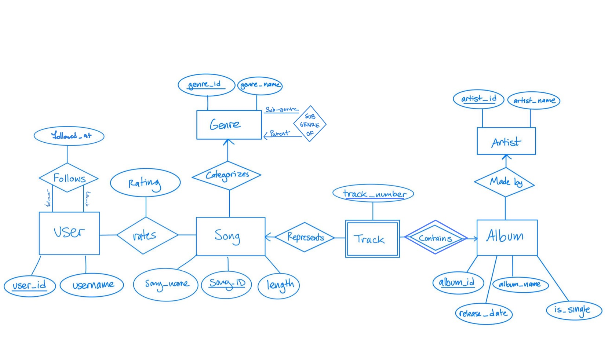

# ERD

## Entities and Attributes

- **User:** Stores information about each user, including a unique user_id and username. Users can rate songs through the Rates relationship.
- **Song:** Represents individual songs and stores attributes such as song_id, song_name, and length. Each song has at most one genre. A song does not store its album directly; which release it appears on is recorded through Track. A song also does not store its artist directly; its artists are recorded through the Performed by relationship.
- **Track:** A weak entity set supported by Album. It records a song's position on a specific release. track_number is a partial key: "track 3" only identifies a track within its album, so a track's key is (album_id, track_number).
- **Album:** Stores information about albums, including a unique album_id, album_name, release_date, and whether the album is a single (is_single). Each album has one album artist (the credit for the release as a whole) and can contain multiple songs.
- **Artist:** Stores information about artists using a unique artist_id and artist_name. An artist can be the album artist of multiple albums and can be credited on multiple songs.
- **Genre:** Stores different music genres using a unique genre_id and genre_name. Each song is categorized under a genre. A genre can optionally have a parent genre (parent_genre_id), which lets us store sub-genres such as Soft Rock and Punk Rock under Rock. Top-level genres have no parent (NULL).
- **Ratings:** The Rates relationship connects users and songs, allowing users to rate individual songs. The Rating attribute stores the rating given by the user. This creates a many-to-many relationship, since a user can rate many songs and a song can receive ratings from many users.
- **Primary Keys:** Each main entity has a unique identifier (user_id, song_id, album_id, artist_id, and genre_id) to uniquely identify its records. Track, a weak entity set, has no ID of its own and uses (album_id, track_number), combining its album's key with its partial key.

## Relationships 

- **Genre-Song:** One to Many relationship to account for each song having only one main genre, while each genre will have multiple songs under it
- **Genre-Genre (Sub-genre of):** Many to One recursive relationship with two roles, *sub-genre* and *parent*. Each sub-genre has at most one parent genre, while a parent genre can have many sub-genres (e.g. Soft Rock and Punk Rock are both under Rock). A genre cannot be its own parent, and a parent with sub-genres cannot be deleted (ON DELETE RESTRICT).
- **Track-Album (Contains):** Many to One supporting relationship. Each track belongs to exactly one album, and an album can have many tracks. Album's key is part of Track's key, which is why this is drawn as a double diamond.
- **Track-Song (Represents):** Many to One relationship. Each track is exactly one song, while a song can appear as a track on many releases (e.g. a single and later a full album).
- **Song-Album (through Track):** Together, Contains and Represents give a Many to Many relationship between songs and albums. A song is stored once and can appear on several releases, so its ratings are not split between duplicate rows.
- **Album-Artist (Made by):** One to Many relationship represents each album having exactly one album artist, while each artist can create multiple albums. The album artist is the credit for the release as a whole, not necessarily the artist of every song on it. For a compilation, the album artist is "Various Artists".
- **Song-Artist (Performed by):** Many to Many relationship to represent that a song can be credited to several artists (for example a lead artist and a featured artist) while an artist can be credited on many songs. The relationship has one attribute, role, which is either primary or featured (default primary). An artist can be credited on a given song only once. This is stored as the SONG_ARTIST table with key (song_id, artist_id). Deleting a song deletes its credits (ON DELETE CASCADE), and an artist who is credited on a song cannot be deleted (ON DELETE RESTRICT). This keeps a song's artist separate from its album's artist, so a song on a compilation is still credited to its real artist. The ERD cannot require every song to have at least one artist, so this is left to the application.
- **User-Song:** Many to Many relationship to represent that each user has the ability to leave multiple ratings on different songs while each song can have multiple ratings from different users.
- **User-User (Follows):** Many to Many recursive relationship with two roles, *follower* and *followed*. A user can follow many users and be followed by many users, but cannot follow themselves or follow the same user twice. The relationship has one attribute, followed_at, which records when the follow happened.
