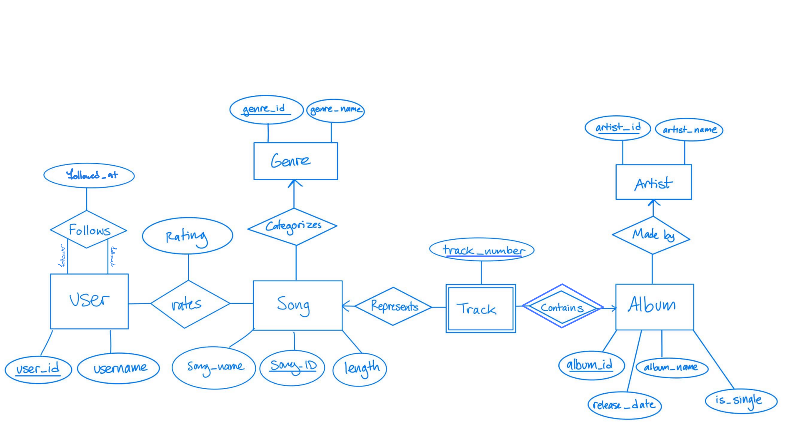

# ERD

## Entities and Attributes

- **User:** Stores information about each user, including a unique user_id and username. Users can rate songs through the Rates relationship.
- **Song:** Represents individual songs and stores attributes such as song_id, song_name, and length. Each song has at most one genre. A song does not store its album directly; which release it appears on is recorded through Track.
- **Track:** A weak entity set supported by Album. It records a song's position on a specific release. track_number is a partial key: "track 3" only identifies a track within its album, so a track's key is (album_id, track_number).
- **Album:** Stores information about albums, including a unique album_id, album_name, release_date, and whether the album is a single (is_single). Albums are associated with an artist and can contain multiple songs.
- **Artist:** Stores information about artists using a unique artist_id and artist_name. An artist can be associated with multiple albums.
- **Genre:** Stores different music genres using a unique genre_id and genre_name. Each song is categorized under a genre.
- **Ratings:** The Rates relationship connects users and songs, allowing users to rate individual songs. The Rating attribute stores the rating given by the user. This creates a many-to-many relationship, since a user can rate many songs and a song can receive ratings from many users.
- **Primary Keys:** Each main entity has a unique identifier (user_id, song_id, album_id, artist_id, and genre_id) to uniquely identify its records. Track, a weak entity set, has no ID of its own and uses (album_id, track_number), combining its album's key with its partial key.

## Relationships 

- **Genre-Song:** One to Many relationship to account for each song having only one main genre, while each genre will have multiple songs under it
- **Track-Album (Contains):** Many to One supporting relationship. Each track belongs to exactly one album, and an album can have many tracks. Album's key is part of Track's key, which is why this is drawn as a double diamond.
- **Track-Song (Represents):** Many to One relationship. Each track is exactly one song, while a song can appear as a track on many releases (e.g. a single and later a full album).
- **Song-Album (through Track):** Together, Contains and Represents give a Many to Many relationship between songs and albums. A song is stored once and can appear on several releases, so its ratings are not split between duplicate rows.
- **Album-Artist:** One to Many relationship represents each album being made by one primary artist, while each artist can create multiple albums.
- **User-Song:** Many to Many relationship to represent that each user has the ability to leave multiple ratings on different songs while each song can have multiple ratings from different users.
